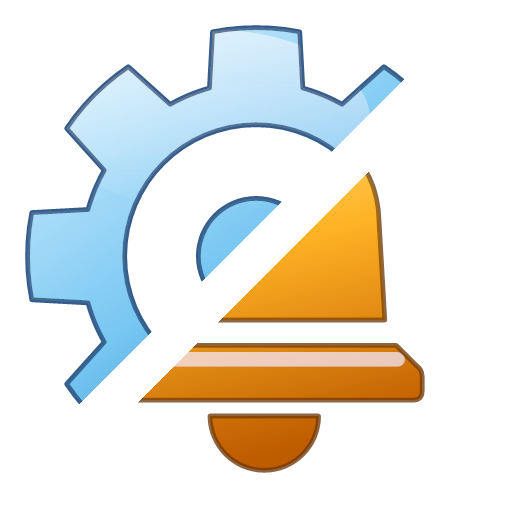
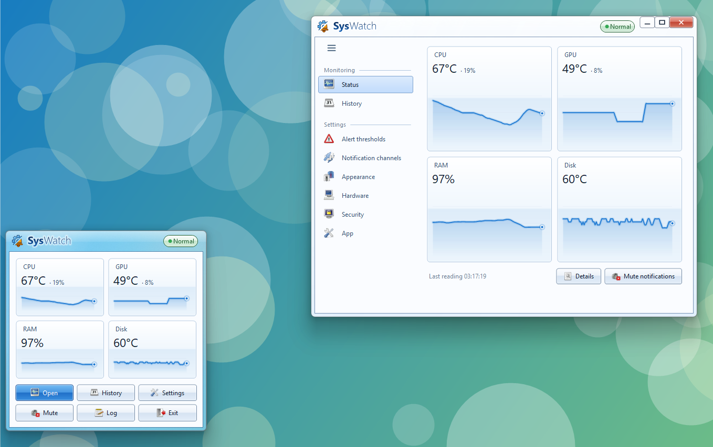
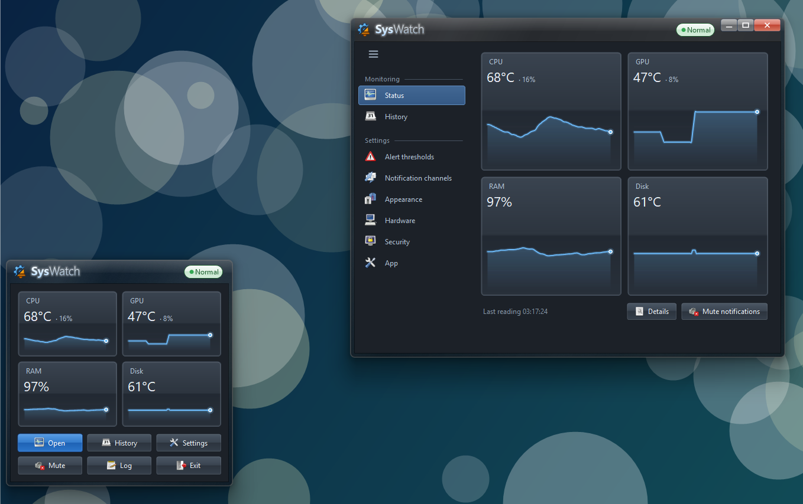

<p align="center">
  
</p>

<h1 align="center">SysWatch</h1>

<p align="center">
  A lightweight Windows tray app that alerts you when your PC runs hot or under heavy load.<br>
  <sub><b>English</b> · <a href="README.tr.md">Türkçe</a></sub>
</p>

<p align="center">
  <a href="https://github.com/zearkreast/SysWatch/releases/latest"></a>
  <a href="https://github.com/zearkreast/SysWatch/releases"></a>
  
  
  <a href="LICENSE"></a>
</p>

<p align="center">
  <a href="https://github.com/zearkreast/SysWatch/releases/latest/download/SysWatch_x64-setup.exe"></a>
  <a href="https://github.com/zearkreast/SysWatch/releases/latest/download/SysWatch_x64-portable.zip"></a>
</p>

<p align="center">
  
</p>

SysWatch tells you when CPU or GPU temperature, or CPU, GPU or RAM usage, stays above a threshold you set. Alerts can come from Windows itself, Telegram, Discord, e-mail (optionally PGP-encrypted) or Signal. When you're away, you can ask for the status from Telegram, Discord or Signal, close a program that hangs, or shut the PC down.

## Features

- **Lightweight:** about 15 MB of memory and practically no CPU at idle. GPU, disk and RAM are read straight from Windows, without loading heavy vendor libraries.
- **Editable thresholds:** for each reading, the limit, how long it must be exceeded, how often to remind you, and how far it must drop to count as back to normal.
- **Five notification channels:** Windows notifications, Telegram, Discord (webhook or bot), e-mail (with optional PGP/MIME encryption) and end-to-end encrypted Signal.
- **Remote commands:** `/status`, `/top`, `/kill`, `/shutdown`, `/set`, `/mute`, optionally protected by a PIN.
- **Privacy:** no telemetry. Tokens and passwords are stored encrypted with Windows DPAPI. In minimal mode, no values or computer name leave the PC.
- **Frutiger Aero interface:** a blurred glass title bar, glossy cards and charts of the last few minutes. Light theme by default, dark theme one click away, and a reduced-motion option.
- **Tray numbers:** chosen readings can sit in the tray as their own numbers.
- **English and Turkish:** the interface follows the Windows display language (Turkish if Windows is in Turkish, English otherwise). Change it under Settings > Appearance > Language.

<p align="center">
  
</p>

## Download and install

| Which one? | File |
| --- | --- |
| **For most people:** the installer. Adds a Start menu entry, can start SysWatch with Windows, and installs .NET 8 itself if it's missing. | [`SysWatch_x64-setup.exe`](https://github.com/zearkreast/SysWatch/releases/latest/download/SysWatch_x64-setup.exe) |
| **Portable:** nothing to install. Unzip and run; settings stay in the `data` folder inside. Needs the [.NET 8 Desktop Runtime](https://dotnet.microsoft.com/download/dotnet/8.0). | [`SysWatch_x64-portable.zip`](https://github.com/zearkreast/SysWatch/releases/latest/download/SysWatch_x64-portable.zip) |

1. Download and open the installer.
2. If a blue "Windows protected your PC" window appears, click **More info**, then **Run anyway**. The file isn't code-signed, which is why the warning appears.
3. When setup finishes, SysWatch sits in the tray. Left-click opens the main window, right-click a small summary panel.

**Requirements:** Windows 10 or 11 (64-bit). SysWatch runs with administrator rights to read sensors and carry out remote commands. The "start with Windows" option does this without a UAC prompt at every sign-in.

**PawnIO for CPU temperature:** reading the processor temperature needs the free [PawnIO](https://pawnio.eu/) driver. Without it, CPU temperature shows as unreadable and everything else works.

**Updating:** run the new installer the same way; your settings stay. **Uninstalling:** from Windows Settings > Apps. The uninstaller asks whether to delete your settings too.

## Using it

- **Left-click:** the main window. The left menu has **Monitoring** (Status, History) and **Settings** (Alert thresholds, Notification channels, Appearance, Hardware, Security, App). The ≡ button collapses it to icons. The window can be moved, resized and maximized.
- **Right-click:** four live cards and Open, History, Settings, Mute, Log and Exit buttons, right above the tray.
- **Status > Details:** every sensor of the enabled hardware groups. Groups that are switched off are listed too, with a link to the Hardware settings.
- **History:** alerts, back-to-normal events and remote commands from the last 7 days.
- **Tray icon:** a red dot in the corner while an alert is active, a gray one while notifications are muted.

Settings, history and the log live in `%APPDATA%\SysWatch\` (in the `data` folder next to the exe for the portable build). The link under Settings > App opens the folder.

## Thresholds

| Metric | Default | Note |
|---|---|---|
| `cpu_temp` | 85°C | Needs PawnIO |
| `gpu_temp` | 83°C | With several GPUs, the highest value |
| `cpu_load` | 90% | |
| `gpu_load` | 95% | |
| `ram` | 90% | |
| `disk_temp` | 70°C | NVMe drives can reach 60-70°C under load |

- **Duration:** alert only when the value stays above the threshold for this many seconds, so short spikes don't trigger anything.
- **Repeat:** how often, in minutes, to remind you while the problem lasts.
- **Hysteresis:** how far below the threshold the value must drop before "back to normal" is sent.

## Setting up notification channels

Everything is under Settings > **Notification channels**. Each channel's page has a **Send test notification** button.

<details>
<summary><b>Telegram</b></summary>

1. In Telegram, send `/newbot` to @BotFather and copy the token it gives you.
2. Send `/start` to your own bot in a private chat.
3. Enter the token in SysWatch and click **Find chat ID**.
4. Choose "Notifications only" or "Notifications + commands" as the mode.

Commands are accepted only from that private chat.
</details>

<details>
<summary><b>Discord</b></summary>

- **Webhook (notifications only, no bot):** Channel settings > Integrations > Webhooks, create one and paste its URL.
- **Bot (notifications + slash commands, no server needed):**
  1. Create an application and a bot at https://discord.com/developers/applications and copy the token.
  2. On the **Installation** tab, tick "User Install".
  3. Click **Add to my account** in SysWatch and add the bot to your account. It can then DM you without a shared server.
  4. Enter your own ID as the **Allowed user ID** (Discord > Advanced > Developer Mode, then right-click your name > Copy User ID).
  5. Save. Typing `/` in the bot's DM lists the SysWatch commands, and only you see the replies.

  To send notifications to a server channel instead, add the bot with **Add to my server** and enter the channel ID. The Message Content intent is not needed.
</details>

<details>
<summary><b>E-mail (optional PGP)</b></summary>

Enter your SMTP details. For Gmail, use `smtp.gmail.com`, port 587 and an **app password**.

If you choose your own PGP public key (.asc), messages are encrypted with PGP/MIME. You need a PGP-capable client to read them, such as Thunderbird, Proton Mail, or FairEmail + OpenKeychain on Android.
</details>

<details>
<summary><b>Signal (end-to-end encrypted)</b></summary>

1. Download [signal-cli](https://github.com/AsamK/signal-cli/releases) and unpack it to a folder (it needs Java 21+).
2. Set up the account in one of two ways:
   - **As a device linked to your own account (no extra number):** turn the link printed by `signal-cli link -n SysWatch` into a QR code and scan it on your phone under Signal > Settings > Linked devices. Tick "Note to Self" and enter your own number as the account number.
   - **With a separate number:** `signal-cli -a +1... register`, then `verify CODE`. The account number is the bot's, the recipient number is yours.
3. Choose the path to `signal-cli.bat` in SysWatch.

In "Notifications only" mode nothing runs while idle. In "Notifications + commands" mode signal-cli keeps running and uses 150-250 MB of RAM.
</details>

## Remote commands

| Command | What it does |
|---|---|
| `/status` | Current readings |
| `/top` | The 5 processes using the most CPU/RAM |
| `/kill <name\|pid> [PIN]` | Ends a process. System processes are protected. |
| `/shutdown [minutes] [PIN]` | Asks to shut down; confirm with `/confirm`, cancel with `/cancel` |
| `/thresholds` | Shows the thresholds |
| `/set <metric> <value\|on\|off>` | Changes a threshold, e.g. `/set cpu_temp 80` |
| `/mute <minutes>`, `/unmute` | Mutes / unmutes notifications |

- With a PIN set, `/kill` and `/shutdown` take the PIN as their last argument. After 5 wrong attempts these commands are locked for 15 minutes.
- Commands sent while the PC was off, or older than 2 minutes, are not carried out.
- Replies are in the app's language. Discord shows the slash command descriptions in English or Turkish, depending on your Discord language.

## Privacy

| Channel | End-to-end encrypted? | Who else can read it |
|---|---|---|
| Windows notification | Never leaves the PC | |
| Telegram | No (bots can't use secret chats) | Telegram |
| Discord | No | Discord, members who can see the channel, anyone with the webhook URL |
| E-mail | No | The mail providers |
| E-mail + PGP | Yes (the body) | The subject line is visible, so it stays generic: "SysWatch notification" |
| Signal | Yes | |

- **Minimal mode:** the channel only learns which reading raised the alert ("CPU temperature alert"). No values, process names or computer name are sent. On by default for Telegram and Discord.
- Tokens, passwords, the webhook URL and the PIN are stored in `config.json` encrypted with Windows DPAPI; copied to another user or PC, they can't be decrypted.
- No telemetry. Data only goes to the services you set up.
- Commands are accepted only from the allowed chat, user ID or number. Turn on 2FA for your messaging accounts and use a PIN.

## Resource use

To keep heavy libraries out, GPU temperature and usage (through D3DKMT, the interface Task Manager uses), disk temperature (the NVMe health log) and RAM are read straight from Windows. The CPU is read with [LibreHardwareMonitor](https://github.com/LibreHardwareMonitor/LibreHardwareMonitor). The "GPU detailed" and "Disk detailed" options under Settings > Hardware show more sensors (GPU hot spot, SMART values and so on) but each costs about 40 MB more memory. The window only takes memory while it's open.

## Building from source

Needs the [.NET 8 SDK](https://dotnet.microsoft.com/download/dotnet/8.0).

```powershell
dotnet build -c Release
```

The release files (installer and portable zip) go to `dist\`. The installer needs [Inno Setup 6](https://jrsoftware.org/isinfo.php); without it, only the portable zip is built.

```powershell
.\scripts\build-release.ps1
```

Releases are published by the **Release** workflow in GitHub Actions (Actions > Release > Run workflow). It takes the version from `<Version>` in `SysWatch.csproj` and the release notes from `docs/releases/<version>.md`.

## License

SysWatch is free software under the [GNU General Public License v3.0](LICENSE). The libraries and artwork it uses come under their own licenses; see [THIRD-PARTY-NOTICES.md](THIRD-PARTY-NOTICES.md) and the [`licenses/`](licenses) folder. The Discord, Telegram and Signal logos are trademarks of their owners and are used only to label the matching channel.
