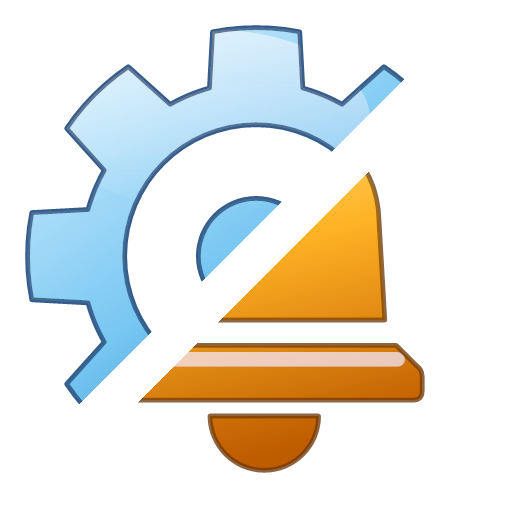
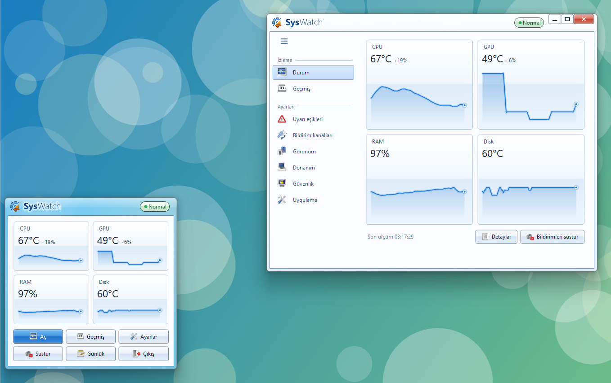
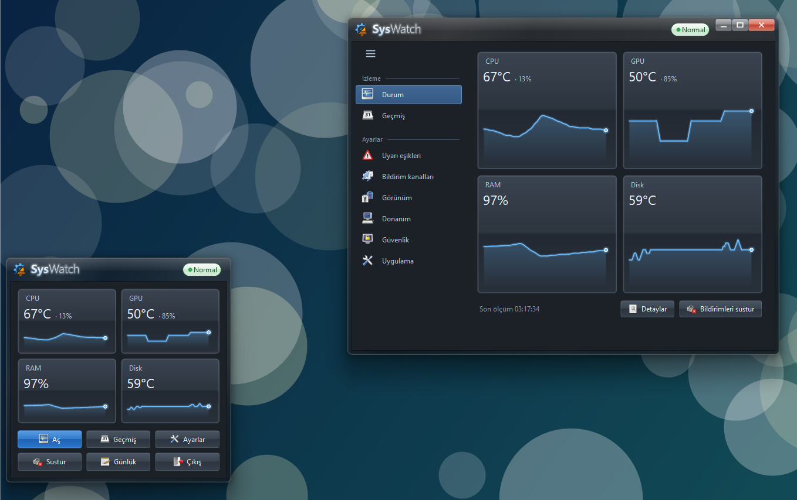

<p align="center">
  
</p>

<h1 align="center">SysWatch</h1>

<p align="center">
  Bilgisayarınız ısınınca ya da zorlanınca haber veren hafif bir Windows tepsi uygulaması.<br>
  <sub><a href="README.md">English</a> · <b>Türkçe</b></sub>
</p>

<p align="center">
  <a href="https://github.com/zearkreast/SysWatch/releases/latest"></a>
  <a href="https://github.com/zearkreast/SysWatch/releases"></a>
  
  
  <a href="LICENSE"></a>
</p>

<p align="center">
  <a href="https://github.com/zearkreast/SysWatch/releases/latest/download/SysWatch_x64-setup.exe"></a>
  <a href="https://github.com/zearkreast/SysWatch/releases/latest/download/SysWatch_x64-portable.zip"></a>
</p>

<p align="center">
  
</p>

CPU veya GPU sıcaklığı, işlemci, ekran kartı ya da RAM kullanımı belirlediğiniz eşiği belirli bir süre aşınca SysWatch size haber verir. Bildirim Windows'un kendisinden, Telegram'dan, Discord'dan, e-postadan (isteğe bağlı PGP ile) ya da Signal'den gelebilir. Evde değilken Telegram, Discord veya Signal'den durumu sorabilir, takılan bir programı kapatabilir ya da bilgisayarı kapatabilirsiniz.

## Özellikler

- **Hafif:** Boşta yaklaşık 15 MB bellek ve neredeyse sıfır işlemci. GPU, disk ve RAM değerleri ağır sürücü kütüphaneleri yüklenmeden doğrudan Windows'tan okunur.
- **Düzenlenebilir eşikler:** Her ölçüm için eşik, ne kadar süre aşılması gerektiği, hatırlatma aralığı ve "normale döndü" payı.
- **Beş bildirim kanalı:** Windows bildirimi, Telegram, Discord (webhook ya da bot), e-posta (PGP/MIME şifreleme seçeneğiyle) ve uçtan uca şifreli Signal.
- **Uzaktan komutlar:** `/status`, `/top`, `/kill`, `/shutdown`, `/set`, `/mute`. İsterseniz PIN ile korunur.
- **Gizlilik:** Telemetri yok. Tokenlar ve parolalar Windows DPAPI ile şifreli saklanır. "Az bilgi" modunda kanala değer ya da bilgisayar adı gitmez.
- **Frutiger Aero arayüz:** Bulanık cam başlık, parlak kartlar, son birkaç dakikanın grafikleri. Açık tema varsayılan, koyu tema bir tık uzakta. "Hareketleri azalt" seçeneği var.
- **Tepside sayılar:** İsterseniz seçtiğiniz okumalar tepside ayrı birer sayı olarak durur.
- **Türkçe ve İngilizce:** Windows'un dili Türkçeyse arayüz Türkçe, değilse İngilizce açılır. Ayarlar > Görünüm > Dil'den değiştirilebilir.

<p align="center">
  
</p>

## İndirme ve kurulum

| Hangisi? | Dosya |
| --- | --- |
| **Çoğu kişi için:** kurulum dosyası. Başlat menüsüne ekler, isterseniz Windows açılınca başlatır, eksikse .NET 8'i kendisi kurar. | [`SysWatch_x64-setup.exe`](https://github.com/zearkreast/SysWatch/releases/latest/download/SysWatch_x64-setup.exe) |
| **Taşınabilir:** kurulum yok. Klasöre açıp çalıştırın, ayarlar klasörün içindeki `data`'da durur. [.NET 8 Masaüstü Çalışma Zamanı](https://dotnet.microsoft.com/download/dotnet/8.0) gerekir. | [`SysWatch_x64-portable.zip`](https://github.com/zearkreast/SysWatch/releases/latest/download/SysWatch_x64-portable.zip) |

1. Kurulum dosyasını indirip açın.
2. Mavi bir "Windows bilgisayarınızı korudu" penceresi çıkarsa **Ek bilgi**'ye, sonra **Yine de çalıştır**'a basın. Dosya kod imzalı olmadığı için bu uyarı çıkar.
3. Kurulum bitince SysWatch tepsiye yerleşir. Sol tık ana pencereyi, sağ tık küçük özet panelini açar.

**Gereksinimler:** Windows 10 veya 11 (64 bit). SysWatch sensörlere erişmek ve uzaktan komutları çalıştırmak için yönetici izniyle çalışır. "Windows açılınca başlat" seçeneği bunu her açılışta UAC sormadan yapar.

**CPU sıcaklığı için PawnIO:** İşlemci sıcaklığını okumak için ücretsiz [PawnIO](https://pawnio.eu/) sürücüsü gerekir. Kurulu değilse CPU sıcaklığı "okunamıyor" görünür, diğer her şey çalışır.

**Güncelleme:** Yeni kurulum dosyasını aynı şekilde çalıştırın, ayarlarınız kalır. **Kaldırma:** Windows Ayarlar > Uygulamalar'dan. Kaldırıcı ayarlarınızı da silmek isteyip istemediğinizi sorar.

## Kullanım

- **Sol tık:** Ana pencere. Sol menüde **İzleme** (Durum, Geçmiş) ve **Ayarlar** (Uyarı eşikleri, Bildirim kanalları, Görünüm, Donanım, Güvenlik, Uygulama) var. Menü ≡ düğmesiyle simgelere daraltılır. Pencere taşınır, boyutlandırılır, ekranı kaplayabilir.
- **Sağ tık:** Tepsinin hemen üstünde dört canlı kart ve Aç, Geçmiş, Ayarlar, Sustur, Günlük, Çıkış düğmeleri.
- **Durum > Detaylar:** Açık donanım gruplarının bütün sensörleri. Kapalı gruplar da listelenir, Donanım ayarlarına bağlantıyla.
- **Geçmiş:** Son 7 günün uyarıları, "normale döndü" kayıtları ve uzaktan gelen komutlar.
- **Tepsi simgesi:** Uyarı varken köşesinde kırmızı, bildirimler susturulmuşken gri bir nokta çıkar.

Ayarlar, geçmiş ve günlük `%APPDATA%\SysWatch\` klasöründe durur (taşınabilir sürümde exe'nin yanındaki `data` klasöründe). Ayarlar > Uygulama'daki bağlantı klasörü açar.

## Eşikler

| Metrik | Varsayılan | Not |
|---|---|---|
| `cpu_temp` | 85°C | PawnIO gerekir |
| `gpu_temp` | 83°C | Birden fazla GPU varsa en yüksek değer |
| `cpu_load` | %90 | |
| `gpu_load` | %95 | |
| `ram` | %90 | |
| `disk_temp` | 70°C | NVMe diskler yük altında 60-70°C'ye çıkabilir |

- **Süre:** Değer bu kadar saniye eşiğin üstünde kalırsa uyarı verilir. Kısa sıçramalar uyarı tetiklemez.
- **Tekrar:** Sorun sürerse kaç dakikada bir hatırlatılacağı.
- **Histerezis:** "Normale döndü" bildirimi için değerin eşiğin bu kadar altına inmesi gerekir.

## Bildirim kanallarını kurma

Hepsi Ayarlar > **Bildirim kanalları** sayfasından yapılır. Her kanalın sayfasında bir **Test bildirimi gönder** düğmesi vardır.

<details>
<summary><b>Telegram</b></summary>

1. Telegram'da @BotFather'a `/newbot` yazın ve verilen token'ı alın.
2. Kendi botunuza özel mesajla `/start` yazın.
3. SysWatch'ta token'ı girin ve **Chat ID bul**'a basın.
4. Mod olarak "Sadece bildirim" ya da "Bildirim + komut" seçin.

Komutlar yalnızca bu özel sohbetten kabul edilir.
</details>

<details>
<summary><b>Discord</b></summary>

- **Webhook (sadece bildirim, bot gerekmez):** Kanal ayarları > Entegrasyonlar > Webhook oluşturun, URL'yi yapıştırın.
- **Bot (bildirim + slash komutları, sunucu gerekmez):**
  1. https://discord.com/developers/applications adresinde bir uygulama ve bot oluşturun, token'ı alın.
  2. **Installation** sekmesinde "User Install" kutusunu işaretleyin.
  3. SysWatch'ta **Hesabıma ekle**'ye basıp botu hesabınıza ekleyin. Bot size DM'den yazar, ortak sunucu gerekmez.
  4. **İzinli kullanıcı ID**'ye kendi ID'nizi yazın (Discord > Gelişmiş > Geliştirici Modu, sonra adınıza sağ tık > Kullanıcı ID'sini Kopyala).
  5. Kaydedin. Botla DM'de `/` yazınca SysWatch komutları çıkar, cevapları yalnızca siz görürsünüz.

  Bildirimler bir sunucu kanalına gitsin isterseniz **Sunucuma ekle** ile botu ekleyip Kanal ID'yi girin. Message Content Intent gerekmez.
</details>

<details>
<summary><b>E-posta (isteğe bağlı PGP)</b></summary>

SMTP bilgilerini girin. Gmail için `smtp.gmail.com`, port 587 ve bir **uygulama şifresi** gerekir.

Kendi PGP açık anahtarınızı (.asc) seçerseniz mail PGP/MIME ile şifrelenir. Açmak için PGP destekli bir istemci gerekir: Thunderbird, Proton Mail ya da Android'de FairEmail + OpenKeychain.
</details>

<details>
<summary><b>Signal (uçtan uca şifreli)</b></summary>

1. [signal-cli](https://github.com/AsamK/signal-cli/releases)'yi indirip bir klasöre açın (Java 21+ gerekir).
2. Hesabı kurun:
   - **Kendi hesabınıza bağlı cihaz (ek numara gerekmez):** `signal-cli link -n SysWatch` komutunun verdiği bağlantıyı QR koda çevirip telefonda Signal > Ayarlar > Bağlı cihazlar'dan okutun. "Kendime Not"u işaretleyin, hesap numarasına kendi numaranızı yazın.
   - **Ayrı numara:** `signal-cli -a +90... register`, ardından `verify KOD`. Hesap numarası botun, alıcı numara sizin numaranızdır.
3. SysWatch'ta `signal-cli.bat` dosyasının yolunu seçin.

"Sadece bildirim" modunda boşta hiçbir yük yoktur. "Bildirim + komut" modunda signal-cli sürekli çalışır ve 150-250 MB RAM kullanır.
</details>

## Uzaktan komutlar

| Komut | Ne yapar |
|---|---|
| `/status` | Anlık değerler |
| `/top` | En çok CPU/RAM kullanan 5 işlem |
| `/kill <ad\|pid> [PIN]` | İşlemi sonlandırır. Sistem işlemleri korunur. |
| `/shutdown [dakika] [PIN]` | Kapatma ister; `/confirm` ile onaylanır, `/cancel` ile iptal edilir |
| `/thresholds` | Eşikleri gösterir |
| `/set <metrik> <değer\|on\|off>` | Eşik değiştirir, ör. `/set cpu_temp 80` |
| `/mute <dakika>`, `/unmute` | Bildirimleri susturur / açar |

- PIN açıksa `/kill` ve `/shutdown` komutlarında PIN son argüman olarak yazılır. 5 hatalı denemeden sonra bu komutlar 15 dakika kilitlenir.
- Bilgisayar kapalıyken gönderilen ya da 2 dakikadan eski komutlar çalıştırılmaz.

## Gizlilik

| Kanal | Uçtan uca şifreli mi | İçeriği sizin dışınızda görebilenler |
|---|---|---|
| Windows bildirimi | Bilgisayardan çıkmaz | |
| Telegram | Hayır (botlar gizli sohbet kullanamaz) | Telegram |
| Discord | Hayır | Discord, kanalı görebilen üyeler, webhook URL'sine sahip olan biri |
| E-posta | Hayır | Mail sağlayıcıları |
| E-posta + PGP | Evet (gövde) | Konu satırı görünür; bu yüzden genel tutulur: "SysWatch bildirimi" |
| Signal | Evet | |

- **Az bilgi modu:** Kanala yalnızca hangi okumanın uyarı verdiği gider ("CPU sıcaklığı uyarısı var"). Değer, işlem adı ve bilgisayar adı gitmez. Telegram ve Discord'da varsayılan olarak açık.
- Token, şifre, webhook URL'si ve PIN, `config.json` içinde Windows DPAPI ile şifreli saklanır; dosya başka bir kullanıcıya veya bilgisayara kopyalanırsa çözülemez.
- Telemetri yok. Veri yalnızca sizin ayarladığınız servislere gider.
- Komutlar yalnızca izinli sohbet, kullanıcı ID'si veya numaradan kabul edilir. Mesajlaşma hesabınızda 2FA açın ve PIN kullanın.

## Kaynak kullanımı

Ağır kütüphaneler yüklenmesin diye GPU sıcaklığı ve kullanımı (Görev Yöneticisi'nin kullandığı D3DKMT arayüzü), disk sıcaklığı (NVMe sağlık kaydı) ve RAM doğrudan Windows'tan okunur. CPU, [LibreHardwareMonitor](https://github.com/LibreHardwareMonitor/LibreHardwareMonitor) ile okunur. Ayarlar > Donanım'daki "GPU ayrıntılı" ve "Disk ayrıntılı" seçenekleri daha çok sensör gösterir (GPU hot spot, SMART değerleri gibi) ama her biri yaklaşık 40 MB daha fazla bellek kullanır. Pencere yalnızca açıkken bellekte durur.

## Kaynaktan derleme

[.NET 8 SDK](https://dotnet.microsoft.com/download/dotnet/8.0) gerekir.

```powershell
dotnet build -c Release
```

Yayın dosyaları (kurulum ve taşınabilir zip) `dist\` klasörüne çıkar. Kurulum dosyası için [Inno Setup 6](https://jrsoftware.org/isinfo.php) gerekir; yoksa sadece taşınabilir zip üretilir.

```powershell
.\scripts\build-release.ps1
```

Sürümler GitHub Actions'taki **Release** iş akışıyla yayınlanır; iş akışı yalnızca bir sürüm etiketi push'lanınca çalışır. `SysWatch.csproj` içindeki `<Version>`'ı yükseltin, `docs/releases/<sürüm>.md` notlarını ekleyin, `main`'e push'layın, sonra o commit'i etiketleyin:

```powershell
git tag v1.1.0
git push origin v1.1.0
```

## Lisans

SysWatch, [GNU General Public License v3.0](LICENSE) ile lisanslı özgür yazılımdır. Kullandığı kütüphaneler ve görseller kendi lisanslarıyla gelir; ayrıntılar [THIRD-PARTY-NOTICES.md](THIRD-PARTY-NOTICES.md) ve [`licenses/`](licenses) klasöründe. Discord, Telegram ve Signal logoları sahiplerinin ticari markalarıdır ve yalnızca ilgili kanalı göstermek için kullanılır.
